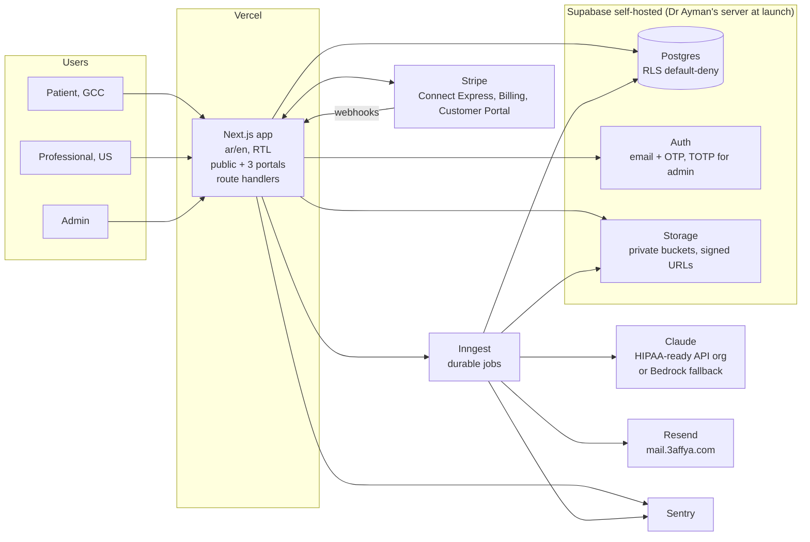
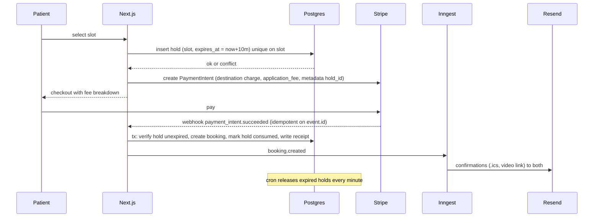

# 3affya Launch Platform: Architecture
`Confidential`

**Date:** 2026-10-16 (ADR-7 and ADR-9 updated 19 Oct) · **Architect:** Yasir · **Builder:** Yasir, solo, with Claude Code · **Read with:** overview, milestones, tasks

## System overview

One Next.js application serves the public site and three portals (patient, professional, admin) in Arabic and English. It talks to a self-hosted Supabase stack (Postgres, Auth, Storage, PostgREST) that runs on Yasir's VPS during the build and moves to a production server in Dr Ayman's name before launch. Slow work (records pipeline, reminders, reconciliation, invite sends) runs as durable Inngest functions so nothing long-running sits inside a request. Stripe Connect Express holds all money flows. Claude processes records under a BAA, behind one internal client so the vendor is configuration. Resend sends transactional email from `mail.3affya.com`. Sentry and an `ai_calls` table give observability.



### Critical flow 1: slot hold and checkout



### Critical flow 2: records upload to summary

```mermaid
sequenceDiagram
  participant Pt as Patient
  participant App as Next.js
  participant ST as Storage
  participant IN as Inngest
  participant AI as Claude
  Pt->>App: upload files (signed upload URLs)
  App->>ST: store under records/{patient_id}/{set_id}/
  App->>IN: records.validate(set_id)
  IN->>IN: validate type, size, pages; compute accepted bytes
  IN->>App: quote = ceil(bytes/1GB) * 9.99
  App-->>Pt: show quote, pay
  App->>IN: records.process(set_id) after payment_intent.succeeded
  loop per page, bounded concurrency
    IN->>AI: extract page to typed JSON with page ref
  end
  IN->>IN: dedupe, build summary + timeline, flag missing/conflicts
  IN->>App: write summary, mark job done, log tokens and cost
  App-->>Pt: notify; summary viewer
  Note over IN: any step failure after retries marks job failed; no capture; retry reuses quote
```

### Critical flow 3: profile claim

Invite email or fax carries a one-time token (hashed in DB, 14-day expiry). Token opens the doctor's pre-seeded page in edit mode; doctor creates an account by email OTP; the `professionals` row moves `unclaimed` to `claimed`; credential uploads go to a private bucket; admin review moves it to `verified` (bookable) or `rejected` (with reason, resubmittable). A used token is dead; a second use shows "already claimed, sign in".

### Critical flow 4: Stripe webhooks

Single endpoint, signature verified, `stripe_events` table with `event_id` primary key inserted before processing (duplicate insert means already handled, return 200). Handlers are pure functions of event payload plus DB state. Money state (bookings paid, refunds, membership status, banner active) is only ever written from webhooks, never from redirect pages.

## Components

| Component | Responsibility | Notes |
|-----------|----------------|-------|
| Next.js app (App Router, TS, Tailwind) | Public site, patient/professional/admin portals, route handlers for Stripe webhooks and server actions | `next-intl` with `[locale]` segment, `dir` attribute per locale, logical CSS properties only |
| Supabase Postgres | All relational data, RLS default-deny, audit log | Self-hosted via Supabase's Docker Compose; never exposed on a public port |
| Supabase Auth | Patients and professionals by email OTP; admin by email plus TOTP | Role in `app_metadata`; a trigger mirrors it to `profiles.role` |
| Supabase Storage | Records (private), credentials (private), ID cards and banners (public) | Signed URLs, 10-minute expiry for records |
| Inngest | Records pipeline, reminders, hold expiry sweep, payout reconciliation, invite batches | Each function idempotent on its key; concurrency caps |
| Stripe | Express accounts, destination charges, refunds, payouts, Billing for memberships and banner, Customer Portal | Platform fee as `application_fee_amount` |
| AI client (`lib/ai`) | One module wrapping the model; pinned model id, schema validation, cost logging, per-job token cap | Vendor behind an env switch: Anthropic HIPAA org or Bedrock |
| Resend | Transactional email, both languages | `mail.3affya.com` subdomain; 3affya.com root stays clean |
| Sentry | Errors and traces with correlation id | PII scrubbing rules on |
| Seed and mapping scripts | Import 66k shortlist, map NPPES taxonomy to 104 groups | Python, run once, reproducible |

## Decisions (ADR-style; the team must not relitigate these)

### ADR-1: Account ownership and hosting during build
- **Decision:** Dev and staging run on Yasir's VPS (or local PC) with synthetic data only. Stripe and the AI vendor organisation are created in Dr Ayman's name from day one. Vercel, Inngest, Resend and the repo sit under ProgrammX until handover, then transfer. The production server is created in Dr Ayman's name by 20 November and ProgrammX operates it under the retainer.
- **Why:** money and PHI contracts belong to the owner; dev infrastructure transfers cleanly and waiting for his sign-ups would cost week 1. Self-hosting removes the Supabase BAA question but makes backups, patching and incident response our job, which the retainer covers.
- **Rejected alternative:** everything under Dr Ayman from day one (slower start); managed Supabase (BAA needs the Team plan at USD 599 per month plus an unpublished HIPAA add-on, checked 16 Oct 2026).
- **Consequence:** the hardening checklist below is a launch gate, and no real patient document may ever be placed on the VPS or a local machine.

### ADR-2: PHI posture at launch
- **Decision:** encryption at rest on the server disk, TLS everywhere, private buckets with short-lived signed URLs, RLS default-deny with object-level tests, per-upload consent record, append-only audit log, deletion that removes content and keeps only the event, PII scrubbed from logs and Sentry. No formal business-associate posture unless counsel requires it (open question 5; Dr Ayman chose to check close to launch, so the review lands with M4's security review by 20 Nov).
- **Why:** 3affya is not a HIPAA covered entity; patient-directed uploads to a consumer platform are governed by the FTC Health Breach Notification Rule, which these controls satisfy. If counsel disagrees, the self-hosted stack already sits on infrastructure Dr Ayman owns, so the upgrade is process and paperwork, not a migration.
- **Rejected alternative:** Supabase Team plus HIPAA add-on (cost and a vendor dependency for a question we may not have).

### ADR-3: AI vendor for the records agent
- **Decision:** Anthropic Claude through a HIPAA-ready API organisation in Dr Ayman's name; BAA request submitted in M1. Fallback trigger: if the organisation is not provisioned by 14 November, switch the env to Claude on AWS Bedrock in Dr Ayman's AWS account (self-serve BAA via AWS Artifact, hard cap via AWS Budgets). The model sits behind `lib/ai`, so the switch is configuration.
- **Why:** Yasir's choice, with the sales-cycle risk made explicit and dated. Note the Anthropic BAA excludes the Batch API, Files API and explicit prompt caching, so the pipeline uses plain Messages calls with inline documents and the cost model assumes no batch discount.
- **Rejected alternative:** Vertex AI (a third cloud account to secure, no advantage here).
- **Spike (M1):** extraction quality on five real Arabic and English documents, including one low-resolution scan; written verdict on whether a dedicated OCR step is needed before the model.

### ADR-4: Records pipeline is a fixed workflow, not an agent
- **Decision:** validate, quote, pay, extract per page to a typed JSON schema with page references, dedupe, summarise and timeline, flag missing and conflicting items, store, notify. Inngest steps, idempotent on `set_id`, exponential backoff with jitter, bounded concurrency, dead-letter after three failures, per-job token cap.
- **Why:** the steps are known; determinism, auditability and explainability to a patient matter more than flexibility. An agent loop would make cost unpredictable on exactly the workload billed per GB.
- **Rejected alternative:** agentic loop with tools.

### ADR-5: Directory seeding
- **Decision:** import the 66k shortlist as `professionals` rows with `status = unclaimed`, `source = nppes`, mapped to the 104 specialty groups. Pages render via ISR with a "listed from public registry, not yet verified" label, no fee, no availability, no checkout, no contact details, an "invite this doctor" button and a "this is me / remove me" flow. Claimed-and-verified rows get the full profile and booking.
- **Why:** SEO surface and the outreach line "your page is already live". NPPES is public domain and the practice is standard among US directories.
- **Rejected alternative:** hidden until claimed (loses both benefits).
- **Consequence:** removal requests get a 48-hour admin SLA; sitemap generated in batches of 5,000.

### ADR-6: Money
- **Decision:** Stripe Connect Express accounts for professionals; destination charges with `application_fee_amount`; 3affya is merchant of record; Stripe Billing with hosted Checkout and Customer Portal for memberships and the banner add-on; all money state written from webhooks only.
- **Why:** Stripe hosts onboarding, KYC, payout dashboard, invoices and card updates, which removes about a dozen screens from a solo build; destination charges keep refunds under 3affya's control.
- **Rejected alternative:** Standard accounts with direct charges (doctor becomes merchant of record, refunds leave our control); manual payouts (ops burden).
- **Rates checked 14 Oct 2026:** 2.9% + 30c per card payment, +1.5% international cards, +1% currency conversion; Connect USD 2 per active account per month, 0.25% + 25c per payout. Recheck before quoting to Dr Ayman.

### ADR-7: Calendar
- **Decision:** professionals set weekly recurring availability plus date exceptions in their IANA timezone; slots generated server-side at a configured duration; all instants stored as `timestamptz` in UTC; a 10-minute hold row with a unique constraint on slot is created with the PaymentIntent and swept by a minute cron; confirmation carries an .ics and the professional's own video link (Zoom or Teams recommended: both work in the UAE and let a landline doctor dial in); reminders at 24h and 1h via Inngest move to the January batch (change log 16 Oct).
- **Why:** the smallest calendar that enforces first-visit revenue and prevents double booking.
- **Rejected alternative:** hosted video (vendor cost, more screens); request-based booking (patients and doctors route around 3affya).

### ADR-8: Auth and roles
- **Decision:** Supabase Auth, email OTP for patients and professionals, email plus mandatory TOTP for admin. Roles `patient`, `professional`, `admin` in `app_metadata`. Authorisation enforced in RLS and in server actions; the UI never decides access.
- **Why:** broken access control is the top risk in a three-role app holding medical data.
- **Rejected alternative:** Clerk (another vendor and another transfer at handover).

### ADR-9: Design lives in code
- **Decision:** brand tokens, type scale and components in the repo; `/brand` page; Dr Ayman approves a deployed clickable prototype. Visual direction is the "3affya Theme Board" Dr Ayman approved on 17 Oct (lagoon water hero, beach-sand ground, two-sided practice card with sand front and lagoon back, Readex Pro, tokens in the project notes 7b); source in `design/theme-board/`. Rasheed's ikioo sign-up screens are the reference for doctor onboarding and the card. MedBot Pro dropped 17 Oct. No Figma pass; print assets produced from the same tokens.
- **Why:** a solo Claude Code build implements each screen once; a Figma pass would drift from the real thing immediately.
- **Consequence:** the written scope confirmation restates the design deliverable in these words.

### ADR-10: Outreach is a separate track
- **Decision:** the platform ships invite tokens, the claim page, an invite email template and an admin screen that tracks invites. Fax and bulk email sending wait on counsel (Junk Fax Prevention Act, CAN-SPAM) and a vendor spike with rates checked at that time; sending runs under the marketing service.
- **Why:** unsolicited advertising faxes carry statutory per-fax damages in the US; the compliant shape is a lawyer's call.
- **Rejected alternative:** sending from the admin panel in weeks 2 to 4.

### ADR-11: Internationalisation
- **Decision:** `next-intl` with `/ar` and `/en` route segments, `ar` default; `dir="rtl"` set on `<html>`; Tailwind logical utilities (`ms-`, `me-`, `ps-`, `pe-`, `start-`, `end-`) only; message catalogues in JSON per locale; dates and numbers via `Intl` with Arabic-Indic digits off by default (Western digits for medical values).
- **Why:** one codebase, one layout system that mirrors correctly; Western digits avoid misreading dosages.
- **Rejected alternative:** two apps; physical CSS with per-locale overrides.

## Integrations and external systems

| System | Purpose | Access owner | Ready? | Limits and cost |
|--------|---------|--------------|--------|-----------------|
| Stripe (Connect, Billing) | Payments, payouts, subscriptions | Dr Ayman (account), Yasir (developer) | Test mode from M1; live mode needs US entity, EIN, bank by 7 Nov | Rates in ADR-6 |
| Anthropic API, HIPAA-ready org | Records extraction and summary | Dr Ayman (org), Yasir (keys) | Request in M1; fallback trigger 14 Nov | Usage at cost to Dr Ayman; no batch discount under BAA; spend cap set in console; per-job token cap in code |
| AWS Bedrock (fallback) | Same, under AWS BAA | Dr Ayman's AWS | Only if triggered | AWS Budgets hard cap |
| Supabase self-hosted | DB, auth, storage | Yasir (build), Dr Ayman (production server) | Dev stack in M1; production by 20 Nov | Server cost per provider chosen in open question 4 |
| Vercel | App hosting, previews | ProgrammX, transfer at handover | Yes | Pro plan; verify current price at transfer |
| Inngest | Durable jobs | ProgrammX, transfer at handover | Yes | Free tier 50k steps per month (checked 16 Oct 2026); paid tiers roughly USD 20 to 75 per month, verify before upgrading |
| Resend | Transactional email | ProgrammX, transfer at handover | DNS on mail.3affya.com in M1 (GoDaddy access in hand) | Verify plan at volume |
| Sentry | Errors and traces | ProgrammX | Yes | Free tier at launch |
| GoDaddy | DNS for 3affya.com | Yasir has access | Yes | n/a |
| NPPES October 2026 file | Directory seed | Yasir | Processed; shortlist xlsx exists | Public domain |

## Data

**In:** patient uploads (PDF, DOCX, JPG, PNG; max 50 MB per file, 2 GB per set), professional credentials (PDF, images), NPPES shortlist (66k rows), Stripe webhooks.
**Stored:** Postgres tables `profiles`, `professionals`, `specialties` (104), `professional_specialties`, `credentials`, `availability_rules`, `availability_exceptions`, `slot_holds`, `bookings`, `receipts`, `refunds`, `memberships`, `banners`, `invites`, `record_sets`, `record_files`, `record_pages`, `record_items` (typed, with `source_page_id`), `record_summaries`, `record_shares`, `consents`, `ai_jobs`, `ai_calls`, `stripe_events`, `audit_log`, `removal_requests`. Files in Storage buckets `records` (private), `credentials` (private), `cards` (public).
**Out:** summaries shared to the chosen professional via signed link with expiry; receipts; .ics; emails.
**Volume at launch:** tens of bookings per week, tens of record sets per week; 66k directory rows; 10x growth changes nothing in this design.
**Retention:** credentials kept while the profile is live; record sets kept until the patient deletes, pending open question 13; audit log append-only; Stripe is the system of record for money.
**Residency:** patients in the GCC, professionals in the US; data on the production server in Dr Ayman's name; no data on ProgrammX machines after handover.
**Synthetic only:** every environment except production uses synthetic or Yasir's own documents.

## Risks and unknowns

| Risk | Impact | Mitigation or spike |
|------|--------|---------------------|
| Scope exceeds a solo 35-day appetite | Launch slips or quality drops | Hosted vendor pages for all non-core screens; cut line agreed in writing; 26 Oct checkpoint re-cuts M3 |
| Stripe live mode not approved by launch | No real payments on 4 Dec | Test mode throughout; live mode is a switch; entity, EIN, bank due 7 Nov; Dr Ayman owns the date |
| Arabic scan extraction quality | Summaries wrong or unreadable | M1 spike on real documents; dedicated OCR step if needed; "unreadable" flag instead of guesses |
| Anthropic HIPAA org not provisioned in time | Records agent slips | Dated fallback to Bedrock on 14 Nov; `lib/ai` makes it configuration |
| Counsel requires a formal business-associate posture | Process and paperwork before launch | Self-hosted stack already on his infrastructure; controls listed here are the baseline |
| Unclaimed-profile complaints | Reputation, takedown demands | Remove-me flow before any outreach; 48-hour SLA; registry label |
| Timezone and DST errors in booking | Missed visits, refunds | UTC storage; tests across Riyadh, Houston, London and the 1 Nov 2026 DST boundary in M3 acceptance |
| Self-hosted server outage or data loss | Platform down, records lost | Nightly encrypted dumps to separate object storage; restore drill in M4; uptime monitor; runbook |
| Webhook duplicates or ordering | Double bookings, double receipts | `stripe_events` idempotency; holds with unique constraint; handlers pure |
| Prompt injection via uploaded documents | Model follows text inside a scan | Documents passed as data in a fixed template; output schema-validated; no tools during extraction |
| Cost runaway on AI | Dr Ayman's bill | Vendor spend cap; per-job token cap; quote before processing; `ai_calls` cost log with daily alert |

## Rigor review

- **Scalability:** stateless app on Vercel; all state in Postgres, Storage, Stripe or Inngest; ISR for 66k pages with sitemap batches; indexes on `professionals(status, specialty, language, location)`, `slot_holds(slot_start, professional_id)`, `record_items(set_id)`; bottleneck is the single Postgres instance, fine at 10x.
- **Reliability:** timeouts on every outbound call (Stripe 20s, AI 120s per page, Resend 10s); retries with backoff and jitter in Inngest; circuit on AI after 5 consecutive failures; holds swept by cron; backups nightly, restore tested in M4; Stripe down means checkout shows a plain message and the hold stays for its window.
- **Security:** Supabase Auth, no custom password handling; RLS default-deny with tests that attempt cross-tenant reads for every table; admin TOTP; secrets in env only, rotation documented; signed URLs 10 minutes; parameterised queries via PostgREST and typed client; dependencies pinned and scanned; no public Postgres port; SSH keys only; fail2ban; automatic security updates; PII scrubbed from Sentry; rate limits on OTP, claim and upload endpoints.
- **Data:** SQL with foreign keys; money and bookings strongly consistent in one transaction; expand and contract migrations; audit log append-only; single source of truth per datum (Stripe for money, Postgres for everything else).
- **Cost:** Dr Ayman's running costs are the server, Vercel, AI usage at cost, Stripe per transaction, and Inngest or Resend if volume exceeds free tiers; nothing scales nonlinearly except AI tokens, which are quoted before every job.
- **Observability:** structured logs with a request id that flows into Inngest run ids; Sentry; `ai_calls` with model, tokens, cost, latency, pass or fail; alerts on checkout error rate, pipeline failure rate, server disk and CPU, daily AI spend.
- **Environments:** `supabase start` locally with seed; VPS staging; production server; same artifact promoted; Stripe test keys everywhere but production; synthetic data only below production.

### Production server hardening checklist (M4 gate)
- [ ] Postgres and all Supabase services bound to localhost or a private network; only 443 and SSH open.
- [ ] SSH key auth only, root login off, fail2ban on, unattended security upgrades on.
- [ ] Disk encryption enabled; TLS via a reverse proxy with auto-renewal.
- [ ] Nightly `pg_dump` encrypted and copied to object storage in a different account; 30-day retention; restore drill passed and logged.
- [ ] Uptime monitor on the API and the app; alerts to Yasir and Dr Ayman.
- [ ] No long-lived service account keys; all secrets in the host env; rotation dates recorded.
- [ ] Budget alerts on the server provider, the AI vendor and Stripe.
- [ ] Audit log verified append-only (no update or delete grants).
- [ ] Runbook in the repo: restart, restore, rotate, scale, who to call.

---
ProgrammX · programmx.com · hello@programmx.com
